:::note[关于本文]
本文由 AI 撰写：根据我的做题记录、比赛记录和 GitHub 提交整理成文。数据截至 2026 年 9 月 22 日，都可以通过文中链接核对。
:::

2026 年 1 月到 9 月，我主要在做三件事：练算法、打比赛，给用到的开源项目提 PR，以及维护自己 VPS 上的服务。

## 概览

- **比赛**：11 个赛事阶段，4 金 4 银 3 铜，包括 ICPC 贵州省赛银奖（总榜第 10）、百度之星人才专项决赛金奖、码蹄杯本科国赛金奖。
- **刷题**：Codeforces 和 AtCoder 今年新增 AC 472 题。AtCoder 从 1083 涨到 1463，Codeforces 当前 1617（Expert）。
- **开源**：5 个 PR 已合并，主要是给 QQ Chat Exporter 做的 WebSocket 认证和私聊漫游导出。
- **项目**：博客和配套的 OJFlare、CodeFlare、MacFlare；VPS 上自部署了 DMOJ 评测系统、邮件服务等 19 组 Docker Compose 项目。

## 比赛

截至 9 月 22 日，今年参加了 11 个赛事阶段，拿到 4 金、4 银、3 铜。团队赛的成绩是和队友一起拿的。证书附在[文末](#附获奖证书)。

| 比赛日期 | 赛事 | 获奖 |
| --- | --- | --- |
| 2026-09-13 | 2026–2027 ICPC 贵州省赛 | 银奖，总榜第 10 名 |
| 2026-08-21 | 第八届码蹄杯 · 本科院校赛道国赛 | 金奖 |
| 2026-08-21 | 第 22 届百度之星 · 人才专项赛道决赛 | 金奖 |
| 2026-07-29 | ICPC 沈阳全国邀请赛 | 铜奖 |
| 2026-06-14 | 第十四届重庆市大学生程序设计大赛 | 银奖 |
| 2026-05-31 | 第十八届四川省大学生程序设计大赛 | 银奖 |
| 2026-05-30 | CCPC 全国邀请赛（福州） | 银奖 |
| 2026-05-24 | CCPC 全国邀请赛（秦皇岛） | 铜奖 |
| 2026-05-14 | 第八届码蹄杯 · 本科院校赛道四川省赛 | 金奖 |
| 2026-05-14 | 第 22 届百度之星 · 人才专项赛道省赛 | 金奖 |
| 2026-05-02 | ICPC 陕西全国邀请赛（西安） | 铜奖 |

## 算法训练

### 数据

| 平台 | 今年新增通过 | 今年计分赛 | 年初 Rating → 当前 | 变化 |
| --- | ---: | ---: | ---: | ---: |
| [Codeforces](https://codeforces.com/profile/Lucius7) | 246 题 | 6 场 | 1718 → 1617 | −101 |
| [AtCoder Algorithm](https://atcoder.jp/users/Lucius7) | 226 题 | 27 场 | 1083 → 1463 | +380 |

过题数按每道题第一次 AC 计算，不算重复提交和往年已经过的题，数据来自 [OJFlare](https://ojflare.lucius7.dev/) 9 月 21 日 12:59（UTC+8）的快照。计分赛场次和 Rating 取自 9 月 22 日的 [Codeforces](https://codeforces.com/contests/with/Lucius7) 和 [AtCoder](https://atcoder.jp/users/Lucius7/history) 官方记录。

AtCoder 涨了 380 分，现在是水色。Codeforces 是 Expert，但今年掉了 101 分：只打了 6 场计分赛，最后一场在 7 月 18 日，8、9 月的练习还没有反映到 Rating 上。

### 代表题目

Codeforces 今年新增的 246 题里，142 题有官方难度，其中 26 题在 2000 分及以上，另外 104 题没有难度评分。这段时间练得最多的是图论建模。下面几题都是今年第一次通过，代码在 [CodeFlare](https://codeflare.lucius7.dev/) 上：

| 题目 | 做法 |
| --- | --- |
| [CF160D · 2300](https://codeflare.lucius7.dev/code.html?path=Codeforces/160/D.cpp) | 边按权值分组跑 Kruskal。每组同权边先在并查集缩好的图上找桥，判断每条边是一定在、可能在还是不在 MST 中，整组判完再合并，避免同权边互相影响。 |
| [CF1215F · 2700](https://codeflare.lucius7.dev/code.html?path=Codeforces/1215/F.cpp) | 2-SAT。站点选择和功率阈值都设成布尔变量，把区间限制、互斥关系和阈值的单调性写成蕴含边，跑 SCC 求解。 |
| [CF241E · 2600](https://codeflare.lucius7.dev/code.html?path=Codeforces/241/E.cpp) | 先筛出在起点到终点路径上的点，只对这些点建差分约束，再用势能差给边赋权。 |
| [ABC476E](https://codeflare.lucius7.dev/code.html?path=AtCoder/abc476/e.cpp) | 线段树维护区间最值，配合按值存位置的集合找出要交换的位置，交换后同步更新数组、线段树和集合。 |
| [ABC445F](https://codeflare.lucius7.dev/code.html?path=AtCoder/abc445/f.cpp) | min-plus 矩阵快速幂，加速最小代价转移。 |
| [ABC471E](https://codeflare.lucius7.dev/code.html?path=AtCoder/abc471/e.cpp) | 展开子集元素和的平方，分成单个元素和元素对两部分算贡献。 |
| [ABC476F](https://codeflare.lucius7.dev/code.html?path=AtCoder/abc476/f.cpp) | 坐标换成 `i+j`、`i-j`，按对角线聚合权重，再用前后缀和算加权距离。 |

这些大多是专题练习或补题时写的。比赛里没有标签提示，能不能及时想到模型是另一回事。

### 比赛中暴露的问题

**Codeforces**：6 场计分赛都过了 A、B、C，其中只有两场再多过一题（一场 D，一场 D1）。中段题还不稳定，前面的题也会因为错误提交丢时间。

[Round 1111](https://codeforces.com/contest/2247) 是个例子：D1 在第 92 分钟左右通过，D2 在最后 17 分钟里交了 10 次，全部 TLE（[D1 的 AC](https://codeforces.com/contest/2247/submission/383361672)、[D2 第一次 TLE](https://codeforces.com/contest/2247/submission/383365598)、[最后一次 TLE](https://codeforces.com/contest/2247/submission/383373107)）。遇到 TLE 应该先重新估算操作次数和重复计算，决定要不要换算法或数据结构；拖到最后反复提交，已经没有时间重新建模。

**AtCoder**：从 1083 涨到 1463，最高 1475。最近 8 场 ABC 都过了 A 到 D，其中 6 场 5 题、2 场 4 题；ABC467 和 ABC469 是跳过 E 先做出了 F，按题目调整顺序是有用的。7 月的 [ABC467](https://atcoder.jp/contests/abc467/standings?watching=Lucius7) 打出了 2049 的 Performance，但最近 6 场计分赛在 1414–1512 之间，那一场不是常态。

最近的 ABC476，E 在开赛 46 分钟左右通过，F 是第二天补出来的（[赛中提交](https://atcoder.jp/contests/abc476/submissions/79373498)、[赛后补题](https://atcoder.jp/contests/abc476/submissions/79396187)），不算赛时 6 题。

### 接下来怎么练

1. **不看标签的限时混合训练。** 题目以 Codeforces 1700–2000、ABC E/F 和部分 ARC 为主。每题记录建模用时、首交结果、有没有看提示。
2. **提交前先算复杂度。** 写清状态数、单次操作代价和总操作次数，TLE 后先重新估上界。多个数据结构一起维护状态的题，写小数据暴力对拍；套模板前检查重边、下标边界和整数范围。
3. **多打完整比赛。** 用计分赛或完整 VP 检验专题训练的效果，把赛时独立做出、赛后独立补出、看题解后实现分开记录。图论之外继续练 DP、计数和构造。

## 开源贡献

我的 GitHub 账号是 [theLucius7](https://github.com/theLucius7)。用开源项目遇到问题时，我会把修改整理成 PR 提回上游。今年已合并的 PR：

| 合并日期（UTC） | 项目与 PR | 内容 |
| --- | --- | --- |
| 2026-09-21 | [Daily_CF_Problems #15809](https://github.com/Yawn-Sean/Daily_CF_Problems/pull/15809) | 一份 C++ 题解 |
| 2026-09-06 | [QQ Chat Exporter #677](https://github.com/shuakami/qq-chat-exporter/pull/677) | 实验性私聊漫游查询与导出任务 |
| 2026-09-02 | [QQ Chat Exporter #675](https://github.com/shuakami/qq-chat-exporter/pull/675) | WebSocket 连接和重连时的认证 |
| 2026-08-18 | [DreamStream99 #1](https://github.com/ypnomania/DreamStream99/pull/1) | 服务端创建房间、房主与访客权限、播放操作去重、YouTube 同步改进 |
| 2026-07-27 | [EZ-Theme #45](https://github.com/PangHu-Code/EZ-Theme/pull/45) | 适配 Xboard 礼品卡接口、会话字段与时间格式，补上撤销会话和自动续费展示 |

### QQ Chat Exporter

[#675](https://github.com/shuakami/qq-chat-exporter/pull/675)：网页通过 HTTP 认证后，实时进度和流式搜索用的 WebSocket 也要带上访问令牌。这个 PR 让 WebSocket 在连接和重连时都带令牌，HTTPS 入口下使用 `wss`。

[#677](https://github.com/shuakami/qq-chat-exporter/pull/677)：把实验性的私聊漫游查询接进已有的导出流程。

- **入口**：从已有的私聊会话进入，或者输入 QQ 号查出对应的 `peerUid`。
- **流程**：选定日期范围后，服务端创建任务、查找消息锚点并拉取记录，再复用已有的消息解析、资源处理和格式导出。任务页提供进度、取消和下载。
- **任务管理**：处理排队、并发控制、取消和状态恢复。查询限制了日期跨度、消息数量和执行预算，结果会标明是否完整以及停止原因。
- **限制**：依赖已登录的 QQ 和桥接能力，属于实验功能，不保证能取回全部云端历史。

### Daily_CF_Problems

这是一个多人维护的 Codeforces 题解仓库，我会把平时写的题解整理后提交上去，[已合并的题解 PR](https://github.com/Yawn-Sean/Daily_CF_Problems/pulls?q=is%3Apr+is%3Amerged+author%3AtheLucius7) 都可以在这里看到。

## 项目与自建服务

### 博客和配套项目

博客和几个配套项目放在 [xw7qwq](https://github.com/xw7qwq) 组织下：

| 项目 | 作用 |
| --- | --- |
| [nfuwari](https://github.com/xw7qwq/nfuwari) | 博客本体，基于 Astro 和 Fuwari，保存文章与学习笔记 |
| [OJFlare](https://github.com/xw7qwq/ojflare) | 汇总多平台 AC、比赛和 Rating 记录，为最近提交与贡献图提供数据 |
| [CodeFlare](https://github.com/xw7qwq/codeflare) | 归档算法源码和模板，提供独立的代码检索、阅读入口 |
| [MacFlare](https://github.com/xw7qwq/macflare) | 提供 Mac 上的应用和音乐状态，在博客顶部展示应用图标与歌曲信息 |
| [.github](https://github.com/xw7qwq/.github) | 组织介绍、贡献说明和维护约定 |

文章用 Markdown 写，经 Astro 构建后部署到 GitHub Pages，域名通过阿里云 ESA 分发。刷题记录和 Mac 状态由浏览器直接请求各自的公开 API；CodeFlare 是单独的源码站点，文章里的代码都链接到它。OJFlare 按 UTC+8 记录每道题的首次 AC，用来看进度；CodeFlare 保存全部代码，包括模板、尝试和没写完的代码，用来复盘。完整结构见[关于页面](/zh/about/)。

### VPS 上的服务

截至 9 月 22 日，VPS 上跑着 19 组 Docker Compose 项目、34 个容器，另有一些用 systemd 或独立进程管理的服务。它们大多是现成的开源项目，我做的主要是部署、配置，以及按自己的需要改接口和界面。

**DMOJ。** 和算法训练关系最近的是自部署的 [DMOJ](https://github.com/DMOJ/site)，包括网页、后台任务、bridge、评测机、数据库和缓存，另外加了 PDF 服务和 HDU 特判适配服务。一次提交从网页接收、任务分发、编译运行到结果回传，每一环都要自己配置。我改了比赛计分、排名可见性和提交界面，接入了 HDU 的 SPJ。迁移题目时，要同时对齐输入输出约定、checker 行为、编译环境和评分规则。

**邮件。** 服务端用 Stalwart，网页端用 [Bulwark Webmail](https://github.com/bulwarkmail/webmail)。本地改了按域名组织文件夹、JMAP 交互和 Passkey 登录。这些改动要把界面、认证和协议放在一起考虑：界面上的文件夹怎么对应服务端，登录状态怎么带到后续请求，操作失败时怎么提示。

**数据和笔记。** FitBaus 提供 Fitbit 数据看板和只读 API；Fast Note Sync 配合 Obsidian 插件同步笔记和附件；RSSHub、OpenList、TaoSync 负责订阅、文件入口和同步。这几类服务碰到的问题差不多：什么时候更新，失败怎么重试，旧数据还能不能用，怎么知道上次同步成功是什么时候。

**多人同步与接口适配。** [DreamStream99](https://github.com/ypnomania/DreamStream99) 把 Win98 风格的静态前端和房间同步、媒体处理服务分开。多人一起看视频时，播放、暂停、跳转和重新进入房间都要同步，还要处理房主权限和重复操作。NeXus / Xboard 由前端、同源中间层和已有后端组成：中间层把浏览器操作映射到后端接口，前端按接口实际支持的功能显示。EZ-Theme 的兼容 PR 就来自这里。

**其他服务：**

| 用途 | 项目或组件 |
| --- | --- |
| 反向代理与访问入口 | Caddy、Cerberus |
| 资源监控 | Komari、Beszel 及对应 Agent |
| 运维入口 | Nexterm |
| 消息通知 | Apprise |
| 订阅、文件与搜索 | RSSHub、Browserless、OpenList、Meilisearch、TaoSync |
| 日常管理与后台任务 | Wallos、qBittorrent、PT Tools（主要配合 OpenCD 使用）、seed guard |
| 课程信息与工作流实验 | yuketang-cloud |
| 进程与部署管理 | systemd、Supervisor、Docker Compose |

部署之后的日常维护主要是处理异常、跟进上游更新、保存本地修改，以及整理升级和恢复步骤。容器在运行不代表功能正常，还是要实际用一遍。

## 接下来

算法上，要把练习里积累的模型更稳定地用到比赛中。服务上，继续整理升级、备份和恢复步骤，值得展开的部署和适配过程单独写文章。遇到适合提回上游的改动，继续提 PR。

这份记录截至 2026 年 9 月 22 日，之后的进展另写新记录。

## 附：获奖证书

ICPC 贵州省赛（2026–2027 赛季） · 银奖 · 总榜第 10 名

The 2026-2027 ICPC China Guizhou Provincial Programming Contest。比赛日期：2026-09-13。

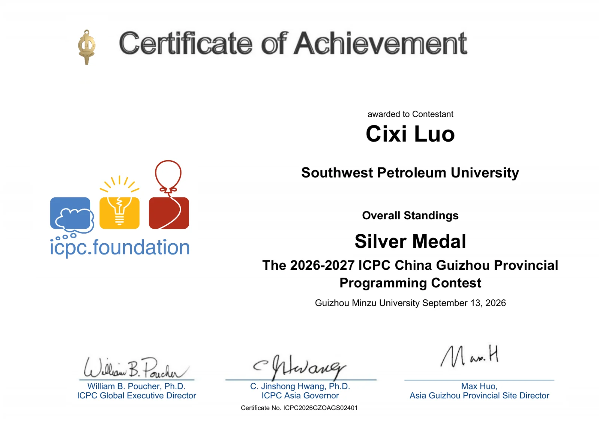

码蹄杯 · 国赛 · 金奖

2026 年第八届码蹄杯程序设计大赛本科院校赛道国赛。比赛日期：2026-08-21。

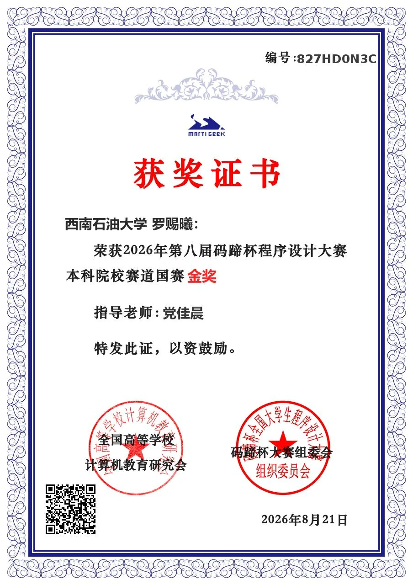

百度之星 · 决赛 · 金奖

第 22 届百度之星程序设计大赛决赛（人才专项赛道）。比赛日期：2026-08-21。

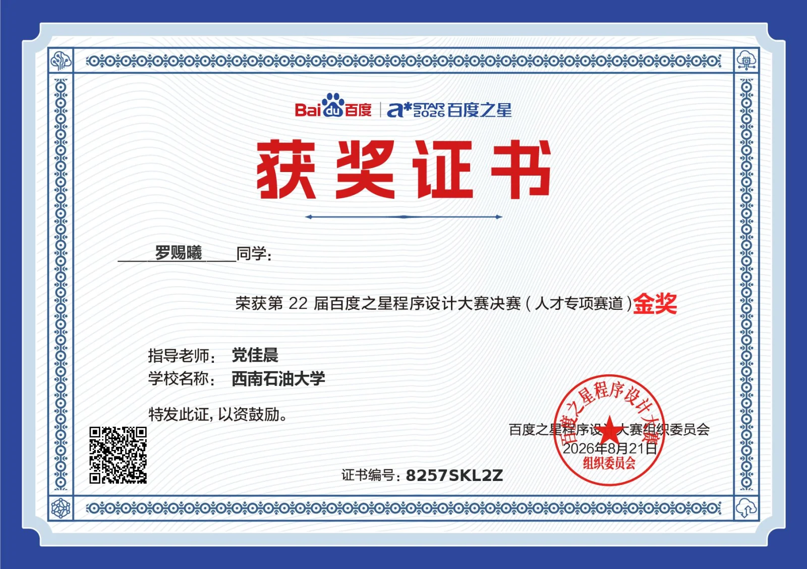

ICPC 沈阳邀请赛 · 铜奖

2026 ICPC China Shenyang National Invitational Programming Contest。比赛日期：2026-07-29。

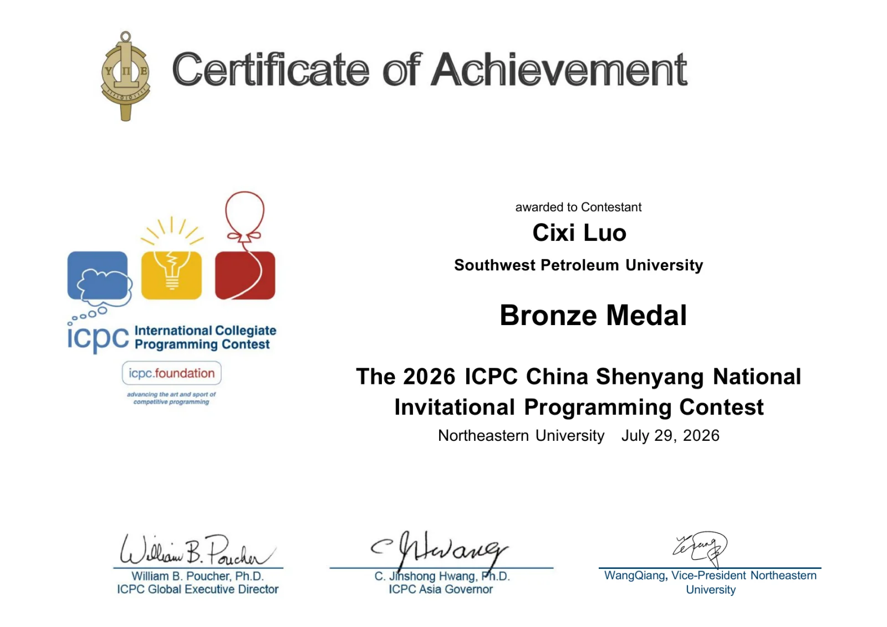

重庆市大学生程序设计大赛 · 银奖

2026 年重庆市第十四届大学生程序设计大赛。比赛日期：2026-06-14。

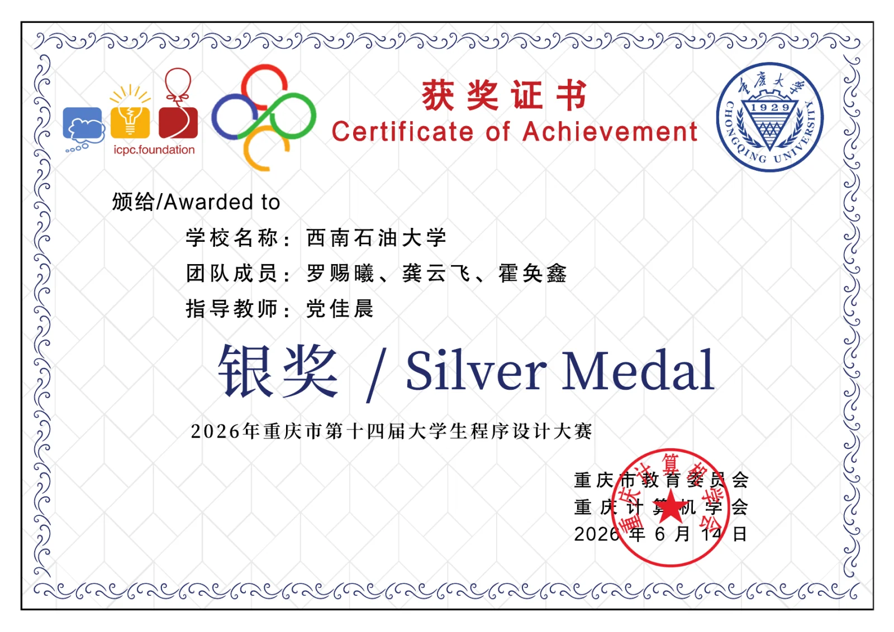

四川省大学生程序设计大赛 · 银奖

第十八届四川省大学生程序设计大赛。比赛日期：2026-05-31。

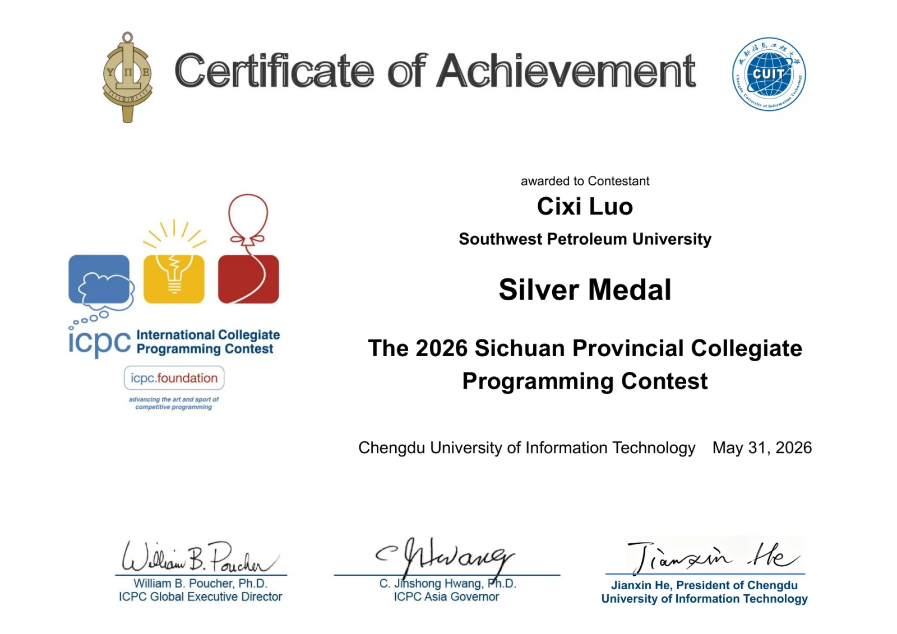

CCPC 福州邀请赛 · 银奖

2026 年中国大学生程序设计竞赛—全国邀请赛（福州）。比赛日期：2026-05-30。

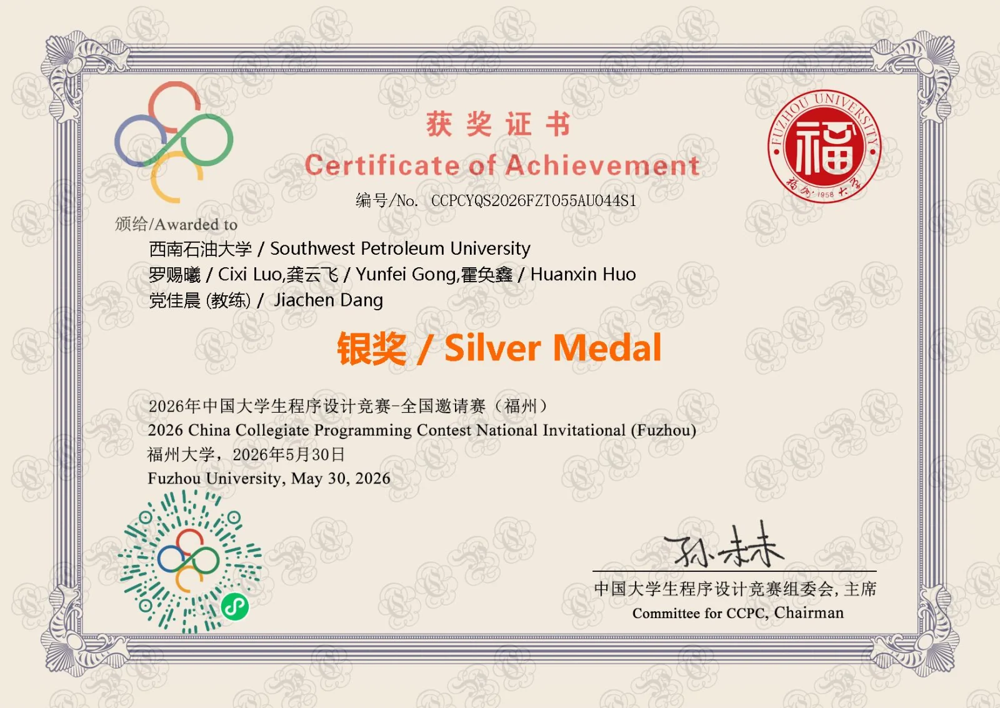

CCPC 秦皇岛邀请赛 · 铜奖

2026 年中国大学生程序设计竞赛全国邀请赛（秦皇岛）。比赛日期：2026-05-24。

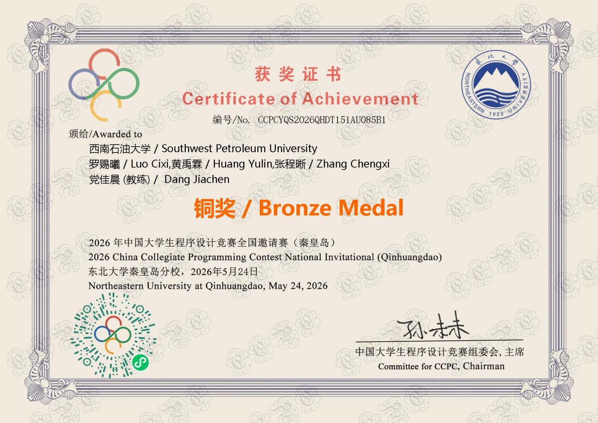

码蹄杯 · 四川省赛 · 金奖

2026 年第八届码蹄杯程序设计大赛本科院校赛道四川赛区省赛。比赛日期：2026-05-14。

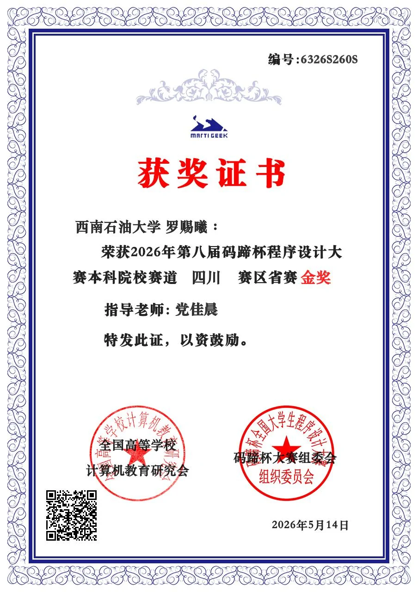

百度之星 · 省赛 · 金奖

第 22 届百度之星程序设计大赛省赛（人才专项赛道）。比赛日期：2026-05-14。

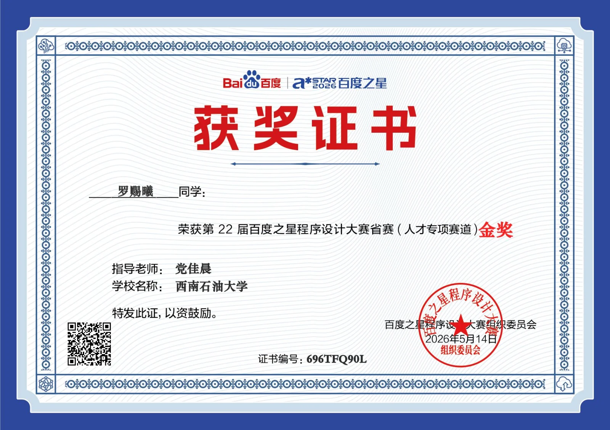

ICPC 陕西邀请赛（西安） · 铜奖

2026 ICPC China Shaanxi National Invitational Programming Contest。比赛日期：2026-05-02。

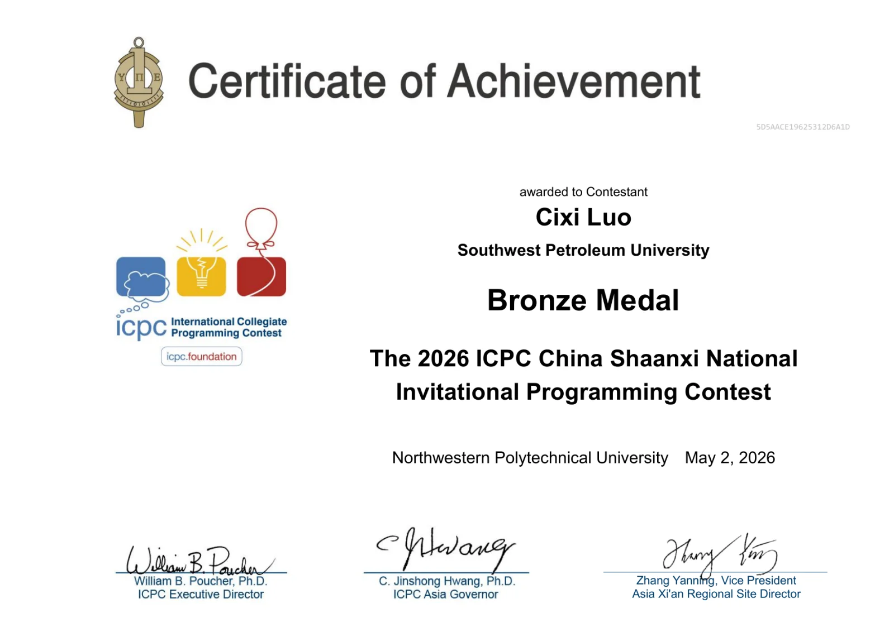

